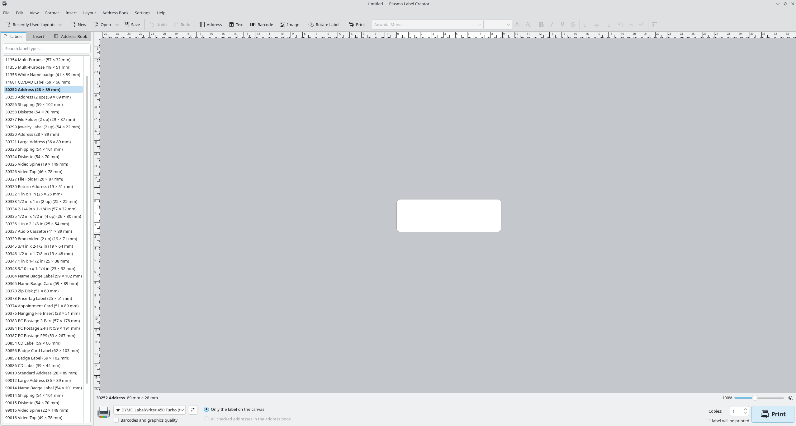

<!--
    SPDX-FileCopyrightText: 2026 nvaert1986 <25772781+nvaert1986@users.noreply.github.com>
    SPDX-License-Identifier: CC0-1.0
-->

# Plasma Label Creator

A KDE Plasma label designer for DYMO LabelWriter and LabelManager printers,
and for ZPL label printers such as the Altec ATP series. It follows the
workflow of DYMO Label Software 8 (DLS) and reads and writes its `.label`
files, so labels move between Linux and Windows unchanged.



> [!WARNING]
> **This project is fully vibe-coded.** Every line was written by an AI
> coding assistant (Claude, by Anthropic) working under the direction of the
> maintainer, who did not write the code by hand. It has been tested
> thoroughly: 16 automated test suites, comparisons against DLS 8's own
> renders, and test prints on real printers, with the assistant's mistakes
> corrected wherever they were found. Even so, nobody has reviewed the code
> line by line the way a human-written project would be. Read it before you
> rely on it, expect rough edges, and please report what you find.

Not affiliated with, endorsed by or supported by DYMO, Newell Brands,
Altec, Zebra Technologies or KDE e.V. See [Trademarks](#trademarks).

## What it does

- **Design labels** on a canvas with rulers and an optional grid to snap
  to: text (also white on black), addresses, barcodes and 2D codes, images,
  DLS clip art, lines and shapes, counters, date/time and curved text. Edit
  text directly on the label, format it from the toolbar, drag objects in
  from the Insert tab or from Dolphin.
- **Barcodes** (zint): DLS's types (Code 128, Code 39, Codabar, 2 of 5,
  ITF-14, EAN, UPC, QR Code, PDF417, POSTNET, PLANET, Intelligent Mail) and
  more that DLS does not have: Data Matrix, Aztec, MaxiCode, Micro QR,
  Code 93, Code 11, MSI Plessey, Pharmacode, GS1-128, GS1 Data Matrix and
  GS1 DataBar (data with `[AI]` application identifiers), HIBC, KIX
  (PostNL) and Royal Mail. DLS cannot show labels that use these.
- **DLS 8 files**: open and save `.label` files, die-cut labels as well as
  LabelManager tape labels. Objects it does not know are kept and written
  back unchanged. DLS address books (`.ABX`) are supported too.
- **Print** through CUPS, with the right driver per printer: DYMO's own
  drivers for LabelWriters and LabelManagers, CUPS's Zebra ZPL driver for
  ZPL printers. Before printing it checks that the label fits what the
  printer offers.
- **Find printers**: DYMO printers plugged in over USB are noticed, and one
  without a CUPS queue gets a "Set Up Printer" button. ZPL printers on the
  network are asked what they are and which labels are loaded.
- **Labels of a kind** (Insert > Label of a Kind...): cable wraps, cable
  flags, patch panels, terminal blocks, breaker panels and rack markers,
  from a few values. DYMO Rhino templates (`.rhino`) open as tape labels.
- **Custom label sizes** with a printable area, and a per-printer print
  offset for printers that need fine adjustment.
- **Print preview**: the pages exactly as the printer receives them, dot
  for dot, stepping through a run where counters or addresses change.
- **Export** a label as a PDF (vector, the label's own size) or as a PNG at
  the printer's resolution.
- **Recently used layouts**: every printed label, with a thumbnail.
- **`plasma-label-creator-render`**: a command-line tool that renders a
  label to PNG or PDF, prints it, or shows what a printer would receive.

## Printers

| Printer | Driver (CUPS) | Status |
|---|---|---|
| DYMO LabelWriter 450 / 450 Turbo | DYMO `dymo-cups-drivers` | Tested on USB and on a Windows share |
| DYMO LabelWriter 4XL, 450 Twin Turbo, DUO and older | DYMO `dymo-cups-drivers` | Should work, untested |
| DYMO LabelWriter 550 / 550 Turbo / 5XL | DYMO LW5xx driver | Untested; needs its own USB or network queue |
| DYMO LabelManager 450D | DYMO `dymo-cups-drivers` (`lm450.ppd`) | Tested on USB with 12 mm tape |
| DYMO LabelManager PnP, 420P, 400, PC (II) | DYMO `dymo-cups-drivers` | Should work, untested |
| Altec ATP-600 Pro | CUPS "Zebra ZPL Label Printer" | Tested on USB and the network |
| Other Altec ATP and Zebra ZPL printers | CUPS "Zebra ZPL Label Printer" | Should work, untested |
| DYMO Rhino 6000 / 6500 | none for Linux | Not supported yet; Rhino *templates* are |

The LabelWriter 550 series uses RFID to identify its labels. This project
does not read or work around that.

### Altec label catalogue

For Altec ATP printers the application offers Altec's die-cut and round
labels by product, those fitting the loaded label length first. The label
sizes and product names come from Altec's public website (altec.nl); they
are listed only to help choose a label and will be removed if Altec asks.

The catalogue is for **Altec products only**. It is shown only when the
printer is an Altec ATP model. Zebra printers, TSC printers and other
TSC-based printers do not get it, even though they print the same way:
for those, make the label size with Layout > Custom Label Size….

## Requirements

- Linux with Qt 6.6 or newer and KDE Frameworks 6, a C++20 compiler,
  CMake 3.22 or newer, zint, CUPS and libudev. Developed and tested on
  Gentoo with Qt 6.11, KDE Frameworks 6.29, zint 2.16, CUPS 2.4 and
  GCC 15.
- To print: CUPS with DYMO's driver for DYMO printers, or CUPS's own Zebra
  ZPL driver for Altec and Zebra printers.
- Optional: DYMO's clip art is not included. If you own DYMO Label
  Software, the Clip Art panel can import it from your own copy of
  `DYMO.DLS.dll`; it stays on your computer.

## Building and installing

```sh
cmake -S . -B build -G Ninja -DCMAKE_BUILD_TYPE=RelWithDebInfo
cmake --build build
ctest --test-dir build --output-on-failure
cmake --install build          # as root
```

**[INSTALL.md](INSTALL.md)** has the full list of requirements with minimum
and tested versions, the packages to install on Gentoo, Debian/Ubuntu,
Fedora and Arch, the build options, installing for one user without root,
and how to set up each kind of printer.

## Using the command-line tool

```sh
# Render a label to an image, and list what is on it
plasma-label-creator-render --info label.label preview.png

# Print it on a CUPS queue
plasma-label-creator-render label.label --send DYMO-LabelWriter-450

# The 1-bit image a queue's driver would receive, without printing
plasma-label-creator-render label.label --queue LabelMANAGER-450 --paper-image paper.png

# Ask a ZPL printer on the network what it is and what is loaded
plasma-label-creator-render --zpl-info 192.0.2.10
```

`plasma-label-creator-render --help` lists every option.

## Source layout

| Path | Contents |
|---|---|
| `src/lib` | `labelcreatorcore`: file formats, layout, rendering, printing. Qt Core, Gui and Network, zint and CUPS only; no widgets or KDE Frameworks |
| `src/cli` | `plasma-label-creator-render` |
| `src/app` | The desktop application (Qt Widgets and KDE Frameworks 6) |
| `autotests` | Qt Test suites and their test data |

## Contributing

Bug reports with the `.label` file (with any personal data removed) and,
for print problems, a photo of the printed label help most. Please do not
attach DYMO's clip art or files taken from DYMO's software.

## Licence

- Core library (`src/lib`): LGPL-2.1-or-later
- Application and command-line tool: GPL-2.0-or-later
- Build files: BSD-2-Clause
- Data files and documentation: CC0-1.0

As a whole, the program is GPL-2.0-or-later; that is the `LICENSE` file.
The full texts of all four are in `LICENSES/`. Each file states its licence
in an SPDX header, or in `REUSE.toml` for files that cannot carry one.

## Trademarks

DYMO, LabelWriter, LabelManager and Rhino are trademarks of Newell Brands.
Altec is a trademark of its owner. Zebra and ZPL are trademarks of Zebra
Technologies. KDE and Plasma are trademarks of KDE e.V. They are used here
only to say which printers, files and desktop this software works with.
