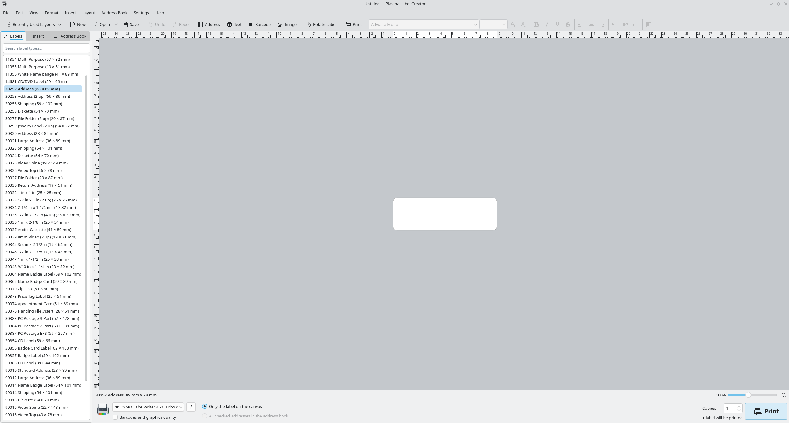

<!--
    SPDX-FileCopyrightText: 2026 nvaert1986 <25772781+nvaert1986@users.noreply.github.com>
    SPDX-License-Identifier: CC0-1.0
-->

# Plasma Label Creator

A Plasma label creator for Linux that supports DYMO LabelWriter and
LabelManager printers and ZPL label printers, such as the Altec ATP series
and Zebra. It opens and saves `.label` files, so labels move between Linux
and Windows unchanged.



> [!WARNING]
> **This project is fully vibe-coded.** Every line was written by an AI
> coding assistant (Claude, by Anthropic) working under the direction of the
> maintainer, who did not write the code by hand. It has been tested
> thoroughly: 19 automated test suites, comparisons with reference labels,
> and test prints on real printers, with the assistant's mistakes
> corrected wherever they were found. Even so, nobody has reviewed the code
> line by line the way a human-written project would be. Read it before you
> rely on it, expect rough edges, and please report what you find.

Not affiliated with, endorsed by or supported by DYMO, Newell Brands,
Altec, Zebra Technologies or KDE e.V. See [Trademarks](#trademarks).

## What it does

- **Design labels** on a canvas with rulers and an optional grid to snap
  to: text (also white on black), addresses, barcodes and 2D codes, images,
  clip art, lines and shapes, counters, date/time and curved text. Edit
  text directly on the label, format it from the toolbar, drag objects in
  from the Insert tab or from Dolphin. Also polygons, stars, arrows and
  SVG drawings, which other label software shows as pictures.
- **Print conditions, growing text and anchoring**: an object prints only
  when a field passes a test; a text box can grow to fit its text, and
  objects anchored to it move along. Guidelines dragged out of the rulers
  to place objects by.
- **Arrange objects**: select several at once, align and distribute them,
  group them, lock them in place, turn them to any angle, put them on
  layers. Text can wrap within its box; objects can be left out of print.
- **Calculated fields** and date offsets, filters and shared counters;
  a **GS1 builder** for GS1-128 and GS1 Data Matrix data.
- **Rolls with labels across** and **continuous rolls** on printers that
  take any label size (Altec, Zebra).
- **Barcodes** (zint): Code 128, Code 39, Codabar, 2 of 5, ITF-14, EAN,
  UPC, QR Code, PDF417, POSTNET, PLANET and Intelligent Mail, and also Data
  Matrix, Aztec, MaxiCode, Micro QR, Code 93, Code 11, MSI Plessey,
  Pharmacode, GS1-128, GS1 Data Matrix and GS1 DataBar (data with `[AI]`
  application identifiers), HIBC, KIX (PostNL) and Royal Mail. Other label
  software that opens the file may not show the types in the second group.
- **`.label` files**: open and save them, die-cut labels as well as
  LabelManager tape labels. Objects it does not know are kept and written
  back unchanged. Labels are saved with DYMO's own label ids (such as
  `Address` for a 30252 or 99010 label). Address books (`.ABX`) are
  supported too. A label's data source and print-time questions are kept in
  the file as a comment, which other label software ignores, so the file
  stays compatible.
- **Print runs**: copies per row and a different label per row from data
  columns, header and trailer labels around a run, and print density,
  darkness and speed per label.
- **Print from data**: a label for each row of a CSV file, an Excel or
  LibreOffice spreadsheet, or a database query (SQLite, ODBC for SQL Server
  and others, MySQL, PostgreSQL). Put fields on the label as `{Column}`, in
  texts, addresses, barcodes, or an image's file path for a picture per row.
  Only queries that read are run, and database passwords are never saved.
  A query can use the answers (`WHERE Serial = {Serial}`), passed as
  values; pictures stored in the database show on the label.
- **Forms at print time**: questions such as a batch number, as text with
  rules (required, length, digits or letters only, a pattern), drop-down
  lists (fixed, or a column of the data), numbers, dates and check boxes.
  A text can be looked up in the data, filling the other fields from the
  row found. The answers fill `{Name}` on every label of the print run.
- **Print-only mode** for people who only print (File > Print-Only Mode, or
  the "Label Printing" launcher): choose a label from a folder, fill in
  its form, tick data rows and print, without editing the label. Counters
  are kept in the label.
- **Versions and print history**: each label saved over keeps its earlier
  versions to restore; every print is logged with its answers and data
  rows, searchable, to open as printed or print again.
- **Print** through CUPS, with the right driver per printer: DYMO's own
  drivers for LabelWriters and LabelManagers, CUPS's Zebra ZPL driver for
  ZPL printers. Before printing it checks that the label fits what the
  printer offers.
- **Find printers**: DYMO printers plugged in over USB are noticed, and one
  without a CUPS queue gets a "Set Up Printer" button. ZPL printers on the
  network are asked what they are and which labels are loaded.
- **Settings** (Settings > Configure Plasma Label Creator…): the font of new
  text, arrow-key and turning steps, rulers in millimetres or inches,
  printer polling, copies, Altec roll defaults, print-only mode (also
  locked, for operator computers), versions and history limits.
- **Printer status**: the print bar shows a stopped queue, jobs waiting, and
  what a network ZPL printer reports (out of labels, head open, paused),
  and warns before printing; Printer Status... shows every label printer.
- **Labels of a kind** (Insert > Label of a Kind...): cable wraps, cable
  flags, patch panels, terminal blocks, breaker panels and rack markers,
  from a few values. DYMO Rhino templates (`.rhino`) open as tape labels.
- **Custom label sizes** with a printable area, and a per-printer print
  offset for printers that need fine adjustment.
- **Print preview**: the pages exactly as the printer receives them, dot
  for dot, stepping through a run where counters or addresses change.
- **Export** a label as a PDF (vector, the label's own size) or as a PNG at
  the printer's resolution, optionally with the label's outline (rounded
  corners too) for a proof.
- **Recently used layouts**: every printed label, with a thumbnail.
- **`plasma-label-creator-render`**: a command-line tool that renders a
  label to PNG or PDF, prints it, or shows what a printer would receive.
- **Automation service** (`plasma-label-creator-automation`): prints
  without anyone at the screen, also when the app is closed. CSV and JSON
  files dropped in watched folders print a label per row; other programs
  send print requests over HTTP (with Qt HTTP Server). Set up in Settings >
  Configure Plasma Label Creator > Automation.

## Printers

| Printer | Driver (CUPS) | Status |
|---|---|---|
| DYMO LabelWriter 450 / 450 Turbo | DYMO `dymo-cups-drivers` | Tested on USB and on a Windows share |
| DYMO LabelWriter 4XL, 450 Twin Turbo, DUO and older | DYMO `dymo-cups-drivers` | Should work, untested |
| DYMO LabelWriter 550 / 550 Turbo / 5XL | DYMO LW5xx driver | Untested; needs its own USB or network queue |
| DYMO LabelManager 450D | DYMO `dymo-cups-drivers` (`lm450.ppd`) | Tested on USB with 12 mm tape |
| DYMO LabelManager PnP, 420P, 400, PC (II) | DYMO `dymo-cups-drivers` | Should work, untested |
| Altec ATP-600 Pro | CUPS "Zebra ZPL Label Printer" | Tested on USB and the network |
| Other Altec ATP and Zebra ZPL printers | CUPS "Zebra ZPL Label Printer" | Should work, untested |
| DYMO Rhino 6000 / 6500 | none for Linux | Not supported yet; Rhino *templates* are |

The LabelWriter 550 series uses RFID to identify its labels. This project
does not read or work around that.

### Altec label catalogue

For Altec ATP printers the application offers Altec's die-cut and round
labels by product, those fitting the loaded label length first; wrap
labels show the white strip that takes print, rolls with labels across
print a row at a time, and continuous rolls take a length of your choice.
The label
sizes and product names come from Altec's public website (altec.nl); they
are listed only to help choose a label and will be removed if Altec asks.

The catalogue is for **Altec products only**. It is shown only when the
printer is an Altec ATP model. Zebra printers, TSC printers and other
TSC-based printers do not get it, even though they print the same way:
for those, make the label size with Layout > Custom Label Size….

## Requirements

- Linux with Qt 6.7 or newer (with Qt SVG) and KDE Frameworks 6, a C++20 compiler,
  CMake 3.22 or newer, zint, CUPS and libudev. Developed and tested on
  Gentoo with Qt 6.11, KDE Frameworks 6.29, zint 2.16, CUPS 2.4 and
  GCC 15.
- To print: CUPS with DYMO's driver for DYMO printers, or CUPS's own Zebra
  ZPL driver for Altec and Zebra printers (also for labels across the roll
  and continuous rolls).
- Optional: the Qt SQL driver of a database (SQLite, ODBC, MySQL,
  PostgreSQL), to print from it; spreadsheets and CSV files need none.
- Optional: Qt HTTP Server (6.8 or newer), for print requests over HTTP in
  the automation service. Without it the service watches folders only, and
  the settings show the HTTP part greyed out.
- Optional: DYMO's clip art is not included. If you own DYMO Label
  Software, the Clip Art panel can import it from your own copy of
  `DYMO.DLS.dll`; it stays on your computer.

## Building and installing

For every user (system-wide, as root):

```sh
cmake -S . -B build -G Ninja -DCMAKE_BUILD_TYPE=RelWithDebInfo -DCMAKE_INSTALL_PREFIX=/usr
cmake --build build
ctest --test-dir build --output-on-failure
cmake --install build          # as root
```

Or for you alone, in your home folder without root: configure with
`-DCMAKE_INSTALL_PREFIX=$HOME/.local` instead, install without root and run
`kbuildsycoca6`; thumbnails and add-ons then need `QT_PLUGIN_PATH` set at
login (see INSTALL.md).

**[INSTALL.md](INSTALL.md)** has the full list of requirements with minimum
and tested versions, the packages to install on Gentoo, Debian/Ubuntu,
Fedora and Arch, the build options, both ways of installing with what each
means for the desktop integration, uninstalling, and how to set up each
kind of printer.

## Using the command-line tool

```sh
# Render a label to an image, and list what is on it
plasma-label-creator-render --info label.label preview.png

# Print it on a CUPS queue
plasma-label-creator-render label.label --send DYMO-LabelWriter-450

# The 1-bit image a queue's driver would receive, without printing
plasma-label-creator-render label.label --queue LabelMANAGER-450 --paper-image paper.png

# Ask a ZPL printer on the network what it is and what is loaded
plasma-label-creator-render --zpl-info 192.0.2.10

# A PDF proof with the label's outline
plasma-label-creator-render --outline label.label proof.pdf
```

`plasma-label-creator-render --help` lists every option.

## Automation service

`plasma-label-creator-automation` prints labels for other programs, in the
background, with the same checks as the Print button: answers to the
label's questions, shared counters, the printer's label types and state,
and for a ZPL printer on the network, whether it is ready and the labels
loaded are the label's length. Counters count on in the label, and every
print goes in the print history. Recent Jobs... on the Automation page
lists what it printed lately, where each job came from, and why a job was
not printed.
Set it up in Settings > Configure Plasma Label Creator > Automation: start
it there or have it start when you log in. On a computer without a desktop
session, run it as a systemd user service:
`systemctl --user enable --now plasma-label-creator-automation`.

**Watched folders.** Each folder has a label, a printer and a number of
copies. A CSV file dropped in it prints a label for each row, its first
line naming the fields; a JSON file is a print job as below. Printed files
move to `printed/`, others to `failed/` with the reason in a `.txt` file.
A file is printed once it has stopped changing for two seconds; programs
that write slowly should write it under another name (`job.csv.part`) and
rename it when done. Counters count on in the label file, so do not keep a
label the service prints open in the app and save it there.

**Over HTTP** (with Qt HTTP Server). From this computer only, or from the
network; every request carries the token shown in the settings. Labels are
named relative to the labels folder set there, and only labels in it print.

```sh
curl -H "Authorization: Bearer $TOKEN" -H "Content-Type: application/json" \
     -d '{"label": "Rack/patch panel", "printer": "Zebra-ZT230", "copies": 1,
          "values": {"Port": "A12"},
          "rows": [{"Serial": "S1"}, {"Serial": "S2"}]}' \
     http://localhost:8631/v1/print
```

| Request | Answer |
|---|---|
| `POST /v1/print` | `{"job": 42, "labels": 2, "warnings": []}`, or `{"error": "..."}` with 400 (the job does not do), 404 (no such label or printer), 409 (the printer cannot take the label or reports a problem: send `"printAnyway": true` to print anyway) or 500 |
| `GET /v1/labels` | The labels in the labels folder, with their fields and questions |
| `GET /v1/printers` | The printers, their state and problems |
| `GET /v1/status` | The service's version and settings |

`values` fill `{fields}` and answer the label's questions on every label;
each of `rows` gives one label. Check boxes take `true` or `false`, dates
`yyyy-MM-dd` or the question's own format.

## Desktop integration

Label files open from Dolphin, show their own icon and a thumbnail of the
label, Dolphin's right-click menu has "Print Label" (print-only mode), and
the launchers have search keywords and right-click actions; AppStream
metadata describes the app to software centres. Each part is optional and
can be left out when building (see [INSTALL.md](INSTALL.md)).

## Add-ons

Plasma Label Creator needs no add-ons. An add-on is a Qt plugin installed
in the `plasma-label-creator` folder under Qt's plugin folders (for
instance `/usr/lib64/qt6/plugins/plasma-label-creator/`, or under
`~/.local/lib64/plugins` with `QT_PLUGIN_PATH` set, see INSTALL.md); each one found is
on until it is switched off under Settings > Add-ons, and takes effect when
the app starts again.

Add-ons build against one header, `PlasmaLabelCreator/plasmalabelcreatorplugin.h`,
installed with the app (and in `src/plugin`). An add-on can put actions in
the File menu and a status indicator in the status bar (whether it is
signed in, say), and open labels it keeps in a folder of its own: the app opens,
prints and saves them as any label file, finds their pictures, data files and
other labels next to them, and tells the add-on when such a label is saved or
printed, also when it is opened again from the recent files or in
print-only mode. Shared counters of its labels can count on with the add-on instead
of in a counter file. That is enough for, say, a team's labels kept on a
server.

## Source layout

| Path | Contents |
|---|---|
| `src/lib` | `labelcreatorcore`: file formats, layout, rendering, printing. Qt Core, Gui and Network, zint and CUPS only; no widgets or KDE Frameworks |
| `src/cli` | `plasma-label-creator-render` |
| `src/service` | `plasma-label-creator-automation`, the automation service (Qt only, Qt HTTP Server optional) |
| `src/app` | The desktop application (Qt Widgets and KDE Frameworks 6) |
| `src/plugin` | The add-on interface, a header only |
| `autotests` | Qt Test suites and their test data |

## Contributing

Bug reports with the `.label` file (with any personal data removed) and,
for print problems, a photo of the printed label help most. Please do not
attach DYMO's clip art or files taken from DYMO's software.

## Changes

What each version changed is in [CHANGELOG.md](CHANGELOG.md).

## Licence

- Core library (`src/lib`): LGPL-2.1-or-later
- Application and command-line tool: GPL-2.0-or-later
- Build files: BSD-2-Clause
- Data files and documentation: CC0-1.0

As a whole, the program is GPL-2.0-or-later; that is the `LICENSE` file.
The full texts of all four are in `LICENSES/`. Each file states its licence
in an SPDX header, or in `REUSE.toml` for files that cannot carry one.

## Trademarks

DYMO, LabelWriter, LabelManager and Rhino are trademarks of Newell Brands.
Altec is a trademark of its owner. Zebra and ZPL are trademarks of Zebra
Technologies. KDE and Plasma are trademarks of KDE e.V. They are used here
only to say which printers, files and desktop this software works with.
